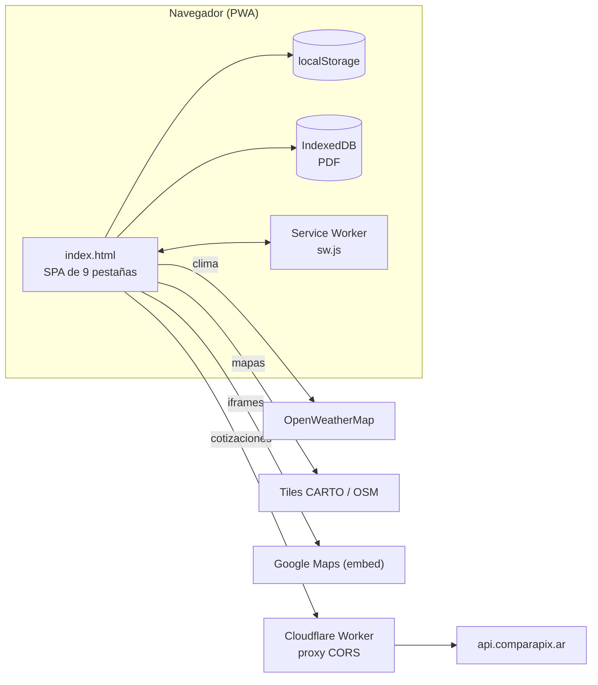
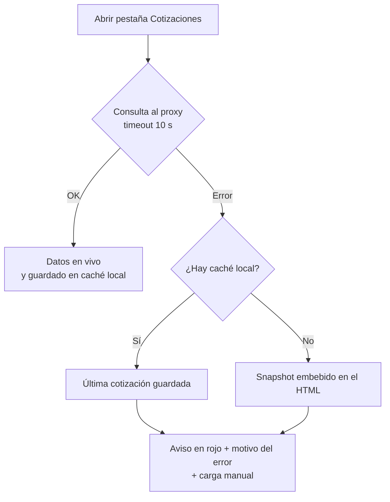

# ✈️ Río + Búzios 2026 — Guía de viaje interactiva


Guía de viaje **personalizada** para un viaje a **Río de Janeiro y Búzios (Brasil) del 10 al 18 de noviembre de 2026**, desarrollada como una *Single Page Application* en **un único archivo HTML** (HTML + CSS + JavaScript vanilla), sin frameworks ni proceso de compilación.

🔗 **Sitio publicado:** <https://brasil-2026.facuatolosa.workers.dev/>

---

## Tabla de contenidos

1. [Descripción general](#1-descripción-general)
2. [Contexto del viaje](#2-contexto-del-viaje)
3. [Funcionalidades](#3-funcionalidades)
4. [Historial de versiones](#4-historial-de-versiones)
5. [Arquitectura y consideraciones técnicas](#5-arquitectura-y-consideraciones-técnicas)
6. [Problemas conocidos y deuda técnica](#6-problemas-conocidos-y-deuda-técnica)
7. [Ejecución local y despliegue](#7-ejecución-local-y-despliegue)
8. [Ideas a futuro](#8-ideas-a-futuro)
9. [Autoría y licencia](#9-autoría-y-licencia)

---

## 1. Descripción general

El proyecto reúne en una sola aplicación web todo lo necesario para **preparar, vivir y organizar** el viaje: dónde se alojan, qué clima esperar y qué ropa llevar, una lista de verificación editable, presupuesto y control de gastos, cotizaciones del real por PIX en tiempo real, recomendaciones turísticas con mapas, frases útiles en portugués con pronunciación, y un repositorio de documentos del viaje (PDF y enlaces).

Objetivos de diseño:

- **Un solo archivo, cero dependencias de build.** Se abre con doble clic o se publica en cualquier hosting estático.
- **Funciona en el celular** (diseño responsivo, instalable como PWA) y también offline para lo ya cargado.
- **Los datos del usuario no salen del dispositivo**: checklist, gastos, enlaces y PDF se guardan en el navegador (`localStorage` / `IndexedDB`).
- **Identidad visual propia**: paleta tropical (azul océano, coral, verde, arena) con tipografías *Fraunces*, *Manrope* y *Space Mono*, y una onda inspirada en el calçadão de Copacabana como motivo recurrente.

La aplicación es de uso personal, pero está pensada para poder reutilizarse como plantilla de otros viajes cambiando los textos, fechas y coordenadas.

## 2. Contexto del viaje

Datos que contiene la guía (visibles en la propia página):

| Concepto | Detalle |
|---|---|
| Fechas | Salida el **10/11/2026 a las 03:20 hs** · regreso con llegada el **19/11/2026 a las 02:20 hs** |
| Vuelo | Directo desde Córdoba con Gol |
| Equipaje | Solo cabina: carry-on de 10 kg + mochila |
| Alojamiento | **3 noches** en Río de Janeiro (Rede Andrade Hotel Canadá, Copacabana) + **5 noches** en Búzios (Pousada Brisas de Búzios, zona Tartaruga) |
| Incluye | Traslados, desayuno y asistencia médica |

---

## 3. Funcionalidades

La aplicación se organiza en **9 pestañas** con barra de navegación fija (*sticky*), más un encabezado con cuenta regresiva y un pie de página personal.

### 3.1 Encabezado (hero) y navegación

- **Cuenta regresiva** en vivo (días, horas, minutos y segundos) hasta la salida del vuelo, calculada con la hora local del dispositivo. Tras la salida muestra *«¡Ya estás de viaje!»* y, pasada la llegada de regreso, un mensaje de fin de viaje.
- **Barra de pestañas fija** con desplazamiento horizontal: arrastre con el mouse en escritorio, gesto táctil en celulares y barra visible en PC.
- **Cambio de pestaña sin saltar al inicio de la página**: si ya se bajó más allá del encabezado, la nueva sección arranca justo debajo de la barra de pestañas; la pestaña activa se centra automáticamente en la barra.
- **Barra de copia de seguridad** (Guardar / Restaurar copia), visible solo en *Checklist* y *Documentos*.

### 3.2 🏨 Alojamiento

- Ficha de cada alojamiento: dirección, noches, valoración, **puntos a favor / a tener en cuenta** según reseñas y un consejo práctico.
- **Mapa de Google Maps embebido** para cada hotel (ubicación exacta del alojamiento).

### 3.3 🌤️ Clima y ropa

- Promedios de noviembre para Río y Búzios (temperaturas, humedad, probabilidad de lluvia, agua de mar).
- **Clima en tiempo real** (OpenWeatherMap): temperatura actual, mínima/máxima del día, humedad y descripción con emoji, para Copacabana y Tartaruga. Se consulta una sola vez, al entrar a la pestaña.
- Recomendaciones de ropa por situación (playa, lluvia/sol, noche) y consejos para armar una valija de cabina.

### 3.4 ✅ Checklist

- **7 categorías y 32 ítems** por defecto: documentación, equipaje de cabina, ropa y calzado, salud y botiquín, dinero y pagos, tecnología y antes de salir de casa.
- Barra de **progreso** (ítems tildados / total) y botón para destildar todo.
- **Modo edición** (botón arriba a la derecha): agregar, modificar y quitar ítems en cada sección. Los cambios y el progreso se guardan automáticamente.
- Migración automática del progreso de la versión 1 (checklist fija) al formato editable.

### 3.5 💰 Presupuesto

- Tabla de **precios de referencia** (comidas, bebidas, transporte, excursiones) y **tres niveles de gasto diario** (mochilero, gama media, cómodo) con una estimación total para los 8 días, sin contar lo ya incluido en el paquete.
- Guía de **medios de pago para argentinos en Brasil** (billetera con Pix, tarjeta de crédito saldada en dólares, efectivo como respaldo y por qué evitar la tarjeta de débito en pesos).

### 3.6 📊 Gastos

- **Gráfico de dona** (CSS `conic-gradient`) con el total gastado en **R$** y leyenda por categoría con monto y porcentaje.
- Alta de gastos con **fecha** (hoy por defecto), descripción, categoría y monto.
- **Categorías administrables** (por defecto: Comida, Transporte, Excursiones, Supermercado y Otros). Al borrar una categoría, sus gastos se reasignan a «Otros»; siempre queda al menos una.
- **Filtros** por texto y por categoría, listado ordenado por fecha descendente y **edición en línea** (guardar / cancelar) o borrado de cada gasto.
- Todo se guarda en el dispositivo.

### 3.7 🗺️ Turismo

- Lugares a visitar en **Río** y **Búzios**, con etiqueta **Gratis / Pago** y consejos de movilidad (metro, Uber/99, combis, buggy, a pie).
- **Un mapa interactivo por destino** (Leaflet) con los puntos de interés mencionados en la pestaña:
  - **Forma del marcador por ciudad**: círculos en Río, rombos en Búzios.
  - **Color por costo**: 🟢 verde = gratis · 🔴 rojo (con insignia «$») = pago · ⬛ azul oscuro con 🏠 = alojamiento.
  - Cada marcador está numerado y abre una ficha con descripción y enlace a Google Maps.
  - Debajo del mapa, una **lista** de los mismos puntos: al tocar uno se abre su ficha en el mapa; el botón ↗ abre el lugar en Google Maps.
  - En pantallas táctiles el mapa arranca «bloqueado» (para no interferir con el scroll) y se activa tocando un aviso.
  - Si el mapa de fondo no carga, los puntos y la lista siguen funcionando.

### 3.8 🗣️ Frases

- Mini-diccionario de **frases útiles en portugués** (saludo, pedir la cuenta, preguntar el precio, comprar bebida, etc.).
- Cada frase se puede **editar** y reproducir con la **Web Speech API** (síntesis de voz `pt-BR` a velocidad 0,9).

### 3.9 📄 Documentos

- **Adjuntar PDF** (arrastrar y soltar o seleccionar): quedan guardados en el navegador (IndexedDB), con opciones para abrir, descargar y quitar.
- **Agregar enlaces** (por ejemplo, de Google Drive) como alternativa, sin duplicar archivos.
- **Categorías con color**: vuelos e itinerario, comprobantes de pago, alojamiento y traslados, asistencia médica y otros (editables luego de cargar).
- Resumen de cantidad y peso total, y avisos claros cuando el navegador no permite guardar archivos de forma permanente.

### 3.10 💱 Cotizaciones

- **Cotización del real al pagar por PIX** según cada app (Cocos, ARQ, Ripio, Astropay, Wayni, Global66, Personal Pay, Mercado Pago, Fiwind, P2P.me, Caipi, Decrypto, Lemon, Belo, Prex y otras), con datos de **ComparaPix**.
- Ordenadas de la más barata a la más cara, con la mejor resaltada, la **diferencia porcentual** contra ella y etiquetas de **Comisiones**, **USDT** y **Dato viejo**.
- Selector **ARS / USD-USDT** y referencia **fuera de PIX** (tarjeta en pesos y tarjeta con resumen cancelado en dólares).
- **Conversor rápido BRL ⇄ ARS** que usa la mejor cotización disponible.
- Actualización automática cada ~60 segundos con la pestaña abierta, botón «Actualizar» y **logos** de cada aplicación.
- **Resiliencia**: si falla la conexión se muestra la última cotización guardada o una cotización de referencia embebida, con el **motivo del error** y una opción para **cargar los datos a mano** (pegando la respuesta de la API).

### 3.11 💾 Copia de seguridad (Checklist y Documentos)

- **Guardar copia**: descarga un HTML nuevo con la checklist editada y los enlaces guardados *dentro* del propio archivo.
- **Restaurar copia**: importa esos datos desde un archivo guardado antes (por ejemplo, para pasarlos a otro dispositivo).
- Al abrir un archivo con copia incorporada, la aplicación decide si usarla comparando fechas y contenido; si la copia es más reciente que los cambios locales, **pregunta** antes de reemplazar.
- Los PDF subidos y los gastos **no** se incluyen en la copia (ver [limitaciones](#6-problemas-conocidos-y-deuda-técnica)).

### 3.12 PWA y pie de página

- **App instalable** (manifest, íconos 192/512 px, `display: standalone`) con **Service Worker** para funcionamiento offline del contenido ya visitado.
- **Pie de página personal** con foto, perfil profesional y enlaces de contacto (mail, LinkedIn y GitHub).

---

## 4. Historial de versiones

El proyecto se desarrolló de forma iterativa el **12/10/2026** (hora de Argentina), con **19 commits** en la rama `main`. Cada commit corresponde a una versión (`Brasil 2026 (vX.Y.Z)`).

### Resumen

| Versión | Hora | Commit | Cambio principal |
|---|---|---|---|
| **v1.0.0** | 17:27 | `c4671d0` | Primera versión: guía estática de 5 secciones |
| **v2.0.0** | 17:33 | `94d97f2` | Cuenta regresiva, checklist editable y pestaña Documentos |
| **v3.0.0** | 17:34 | `d43aa02` | Enlaces de Drive y copia de seguridad exportable/importable |
| **v4.0.0** | 17:36 | `23f7f75` | Pestaña Cotizaciones (ComparaPix) |
| **v5.0.0** | 17:37 | `506b554` | Diagnóstico y carga manual de cotizaciones; cambio de pestaña sin saltar |
| **v5.1.0** | 17:42 | `4f1c5af` | Proxy CORS propio (Cloudflare Workers) |
| **v6.0.0** | 17:45 | `28e3a40` | Clima en tiempo real (OpenWeatherMap) |
| **v7.0.0** | 17:47 | `1e27f83` | Pestaña Frases con Web Speech API |
| **v7.1.0** | 17:50 | `4736e3c` | Ancho completo en encabezados de sección |
| **v8.0.0** | 17:52 | `a411f4c` | Pestaña Control de gastos diarios |
| **v8.0.1** | 17:56 | `a09d955` | Ajuste de tamaño de letra del total de gastos |
| **v8.1.0** | 17:59 | `e5923a5` | Filtros y edición de gastos |
| **v8.2.0** | 18:01 | `0a7e0d7` | Mapas de Google Maps de los alojamientos |
| **v9.0.0** | 18:04 | `2572087` | Barra de copia visible solo en Checklist y Documentos |
| **v10.0.0** | 18:11 | `4c5aea6` | Deploy como PWA, íconos, logos de apps y ajustes visuales |
| **v11.0.0** | 20:08 | `4a8b4d3` | Mapas de puntos de interés con marcadores personalizados |
| **v11.1.0** | 20:25 | `62a7a41` | Alojamientos incluidos en los mapas |
| **v11.2.0** | 22:06 | `1ca0049` | Conversor de moneda y scroll horizontal de secciones |
| **v11.3.0** | 22:43 | `1e42583` | Pie de página personal con datos de contacto |

### Detalle por versión

#### v1.0.0 — Primera versión
- Página HTML estática de **823 líneas** con diseño propio: encabezado con datos del viaje, barra de pestañas y cinco secciones: **Alojamiento, Clima y ropa, Checklist, Presupuesto y Turismo**.
- Checklist con ítems fijos tildables y progreso persistido en `localStorage`.
- Tablas de precios, niveles de gasto, medios de pago y tarjetas de lugares con etiquetas Gratis / Pago.

#### v2.0.0 — Cuenta regresiva, checklist editable y Documentos (+510 / −46 líneas)
- **Cuenta regresiva** al día de salida en el encabezado.
- **Checklist editable**: botón de modo edición para agregar, modificar y quitar ítems; nuevo modelo de datos con identificadores estables y migración del progreso previo.
- **Nueva pestaña Documentos**: carga de PDF por arrastrar y soltar, almacenados en **IndexedDB**; categorías con color; abrir, descargar y quitar.

#### v3.0.0 — Enlaces y copia de seguridad
- Documentos admite **enlaces** además de archivos locales.
- **Guardar / Restaurar copia**: exportación de un HTML con los datos embebidos y validación/normalización de los datos importados.
- Resolución de conflictos entre la copia del archivo y los datos del navegador mediante marca de tiempo.

#### v4.0.0 — Cotizaciones del real por PIX
- Nueva pestaña **Cotizaciones** con tabla ordenada, selector ARS / USD-USDT, referencia fuera de PIX, caché local y *snapshot* embebido de respaldo.

#### v5.0.0 — Robustez de cotizaciones y navegación
- Aviso con el **motivo del error** y caja de **carga manual** de datos.
- Consulta con *timeout* propio (sin `AbortController`).
- Uso de un proxy CORS público (`corsproxy.io`).
- `keepTabsInView`: al cambiar de pestaña ya no se vuelve al inicio de la página.

#### v5.1.0 — Proxy CORS propio
- Se reemplaza el proxy público por un **Cloudflare Worker propio** (`proxy-comparapix…workers.dev`) para consultar la API de ComparaPix.

#### v6.0.0 — Clima en tiempo real
- Integración con **OpenWeatherMap**: temperatura actual, mínima y máxima, humedad y descripción con emoji para Copacabana y Tartaruga; se carga al abrir la pestaña y una sola vez.

#### v7.0.0 — Frases con voz
- Nueva pestaña **Frases** con frases útiles en portugués, editables, y reproducción con **Web Speech API** (`pt-BR`, velocidad 0,9).

#### v7.1.0 — Ancho de secciones
- Los encabezados de sección pasan de `max-width: 640px` a `100%`.

#### v8.0.0 — Control de gastos diarios
- Nueva pestaña **Gastos**: gráfico de dona con `conic-gradient`, total en R$, leyenda por categoría, categorías administrables, alta de gastos y modo edición, con persistencia en `localStorage`.

#### v8.0.1 — Ajuste visual
- El tamaño de la letra del total de gastos baja de `1.4rem` a `1.2rem`.

#### v8.1.0 — Filtros y edición de gastos
- Campo de **fecha** en cada gasto, **filtros** por texto y categoría, orden por fecha descendente y **edición en línea** (guardar / cancelar).

#### v8.2.0 — Mapas de alojamientos
- Mapas de Google Maps incrustados (`iframe`) en las fichas de los dos alojamientos.

#### v9.0.0 — Barra de copia contextual
- La barra de «Guardar / Restaurar copia» solo se muestra en *Checklist* y *Documentos*.

#### v10.0.0 — Deploy como PWA y ajustes visuales
- **PWA**: `manifest.json`, `sw.js`, íconos 192/512, `favicon` y `theme-color`.
- **Logos** de las aplicaciones de la tabla de cotizaciones (carpeta `assets/logos`).
- Ajustes visuales: tablas más compactas, **scroll horizontal** de tablas en celulares, alineación de encabezados con botones.
- Registro del Service Worker al cargar la página.

#### v11.0.0 — Mapas de puntos de interés
- **Un mapa Leaflet por destino** en la pestaña Turismo con marcadores personalizados: **círculos** (Río) y **rombos** (Búzios), **verde** para lugares gratuitos y **rojo con «$»** para los de pago.
- Fichas emergentes, lista de puntos con enlaces a Google Maps, bloqueo táctil del mapa, *fallback* si no carga el mapa de fondo y limpieza de los mapas al exportar la copia.
- **Leaflet 1.9.4 incluido dentro del HTML** (sin dependencia de CDN).
- Se corrige la descripción del *Parque Garota de Ipanema* (queda frente al Arpoador, no junto al hotel).

#### v11.1.0 — Alojamientos en el mapa
- Nuevo tipo de marcador **«Alojamiento»** (🏠, azul oscuro) para el Hotel Canadá y la Pousada Brisas.

#### v11.2.0 — Conversor y scroll de secciones
- **Conversor rápido BRL ⇄ ARS** en Cotizaciones, basado en la mejor cotización de la tabla.
- La barra de pestañas se desplaza **arrastrando** con el mouse y muestra una barra de scroll en PC.
- Ajuste de tamaño del selector ARS / USD-USDT.

#### v11.3.0 — Pie de página personal
- Nuevo *footer* con foto, perfil profesional, enlaces de contacto (mail, LinkedIn, GitHub) y aviso de derechos de autor.

---

## 5. Arquitectura y consideraciones técnicas

### 5.1 Stack

| Capa | Tecnología |
|---|---|
| Estructura | HTML5 semántico (`header`, `nav`, `main`, `section`, `footer`) |
| Estilos | CSS3 con variables personalizadas, Grid, Flexbox, `conic-gradient`, *media queries* |
| Lógica | JavaScript vanilla (ES2017+: `async/await`, módulos por secciones dentro de un mismo `<script>`) |
| Mapas | [Leaflet](https://leafletjs.com/) 1.9.4 (BSD-2-Clause), incluido en línea |
| Tipografías | Google Fonts: Fraunces, Manrope y Space Mono |
| PWA | Web App Manifest + Service Worker |
| Hosting | Cloudflare Workers (sitio estático); el repositorio está en GitHub |

No hay *bundler*, gestor de paquetes, pruebas automatizadas ni integración continua.

### 5.2 Estructura del repositorio

```text
brasil-2026/
├── index.html          # Toda la aplicación (HTML + CSS + JS + Leaflet) ≈ 318 KB, ~3.970 líneas
├── manifest.json       # Web App Manifest (nombre, colores, íconos)
├── sw.js               # Service Worker (caché y modo offline)
├── favicon.ico         # Copia PNG de 512 px del ícono
└── assets/
    ├── icon-192.png / icon-512.png   # Íconos de la PWA
    ├── MiFoto.png                    # Foto del pie de página
    ├── logo-brasil-2026.jfif         # Logo (sin referencias en el código)
    ├── logo-brasil-2026-modified.png # Logo (sin referencias en el código)
    └── logos/                        # 15 logos de apps de la tabla de cotizaciones
```

### 5.3 Organización interna de `index.html`

El archivo sigue un orden fijo:

1. **`<head>`**: metadatos, `manifest`, favicon, `theme-color`, Google Fonts, hoja de estilos propia y CSS de Leaflet.
2. **`<body>`**: encabezado con cuenta regresiva → barra de pestañas → `<main>` con **un `<section class="panel">` por pestaña** → barra de copia → pie de página.
3. **Scripts**: Leaflet en línea → bloque JSON `#embeddedData` (copia de seguridad) → script principal → script de registro del Service Worker.

El script principal está dividido en bloques comentados:

| Bloque | Responsabilidad |
|---|---|
| Pestañas | Cambio de panel, `keepTabsInView`, ocultar/mostrar barra de copia |
| Datos compartidos y estado | Claves de almacenamiento, normalización y validación de copias, estado de checklist y enlaces |
| Checklist (editable) | Render, modo edición, progreso |
| Cuenta regresiva | Temporizador por segundo (`setInterval`) |
| Documentos | IndexedDB (PDF), enlaces, categorías |
| Copia: guardar / restaurar | Exportación e importación del HTML |
| Cotizaciones | Consulta, caché, snapshot, tabla, referencia, conversor |
| Clima en tiempo real | OpenWeatherMap |
| Diccionario / Web Speech | Frases y síntesis de voz |
| Control de gastos | CRUD de gastos y categorías, gráfico, filtros |
| Mapas de Turismo | Leaflet, marcadores, listas, bloqueo táctil |

### 5.3.1 Diagrama de componentes



### 5.4 Navegación (SPA sin enrutador)

- Cada pestaña es un botón con `data-tab="x"` que activa el panel `#panel-x` (clase `.active`); no hay enrutador ni cambios de URL.
- Algunas pestañas cargan datos **de forma diferida** al activarse (clima, cotizaciones, mapas), evitando llamadas innecesarias al iniciar.
- `keepTabsInView` calcula dónde empieza a quedar fija la barra para no devolver al usuario al inicio.

### 5.5 Persistencia de datos

| Dato | Almacenamiento | Clave / nombre |
|---|---|---|
| Checklist (formato actual) | `localStorage` | `rioBuziosChecklist2026_v2` |
| Checklist (formato original, solo lectura para migrar) | `localStorage` | `rioBuziosChecklist2026` |
| Enlaces de documentos | `localStorage` | `rioBuziosLinks2026` |
| Marca de tiempo de la última modificación local | `localStorage` | `rioBuziosMeta2026` |
| Caché de cotizaciones | `localStorage` | `rioBuziosQuotes2026` |
| Gastos y categorías | `localStorage` | `rioBuziosGastos2026` |
| PDF adjuntos | `IndexedDB` | base `rioBuziosDocs2026`, almacén `docs` |
| Recursos offline | Cache Storage | `rio-buzios-cache-v1` |

Todas las escrituras están protegidas con `try/catch`: si el navegador bloquea el almacenamiento, la aplicación sigue funcionando sin persistencia y, en el caso de los PDF, lo informa en pantalla.

### 5.6 Copia de seguridad (exportar / importar)

Un HTML estático no puede reescribirse a sí mismo, por lo que la copia se resuelve así:

1. **Exportar**: se clona el documento (`document.documentElement.cloneNode(true)`), se **limpia** todo lo que el script vuelve a generar (listas, mapas, tablas, estado de pestañas) y se inyecta un JSON con `{ v, savedAt, checklist, links }` en `<script type="application/json" id="embeddedData">` (escapando `<`). El resultado se descarga como `rio-buzios-2026-copia-AAAA-MM-DD.html`.
2. **Abrir un archivo con copia**: `applyEmbedded()` normaliza los datos (límites de tamaño, URLs `http/https`, categorías válidas) y compara el contenido:
   - sin cambios locales → usa la copia en silencio;
   - copia más reciente que lo local → **pregunta** al usuario;
   - cambios locales más nuevos → conserva lo local.
3. **Restaurar**: lee el `#embeddedData` de un archivo elegido por el usuario y reemplaza checklist y enlaces tras confirmar.

### 5.7 Integraciones externas

| Servicio | Uso | Observaciones |
|---|---|---|
| **OpenWeatherMap** (`/data/2.5/weather`) | Clima actual en Copacabana y Tartaruga | Consulta directa desde el navegador con *API key* |
| **ComparaPix** (`api.comparapix.ar/quotes`) | Cotizaciones PIX | Se consulta mediante un **Cloudflare Worker propio** que resuelve CORS |
| **Google Maps** | `iframe` de alojamientos y enlaces de búsqueda por nombre | Sin API key (modo *embed*) |
| **CARTO / OpenStreetMap** | Mapa de fondo de Leaflet | Se intenta primero CARTO (Voyager) y, ante errores, OpenStreetMap |
| **Web Speech API** | Pronunciación de frases | Depende de las voces `pt-BR` instaladas en el dispositivo |
| **Google Fonts** | Tipografías | Requiere conexión la primera vez |

### 5.8 Cotizaciones: flujo y tolerancia a fallos



- La respuesta de la API se **valida** (estructura, números positivos) y se descartan filas inválidas.
- El *timeout* se implementa con `Promise` propio y **sin `AbortController`**: algunas vistas previas reenvían `fetch` con `postMessage` y no pueden clonar la señal de cancelación.
- Los nombres de apps se renderizan con `textContent` (no `innerHTML`), por tratarse de contenido de terceros.
- La tabla usa el campo `buy` (precio *para pagar*) de cada app marcada como PIX (`isPix`), separa USD de USDT y marca datos viejos (`stale`).

### 5.8.1 Mapas de Turismo

- Los puntos viven en una constante `POI` (nombre, coordenadas, costo, descripción, consulta de Google Maps), de donde salen **marcadores, popups y listas**.
- Marcadores creados con `L.divIcon` (HTML/CSS): forma por ciudad, color por costo y número visible; la insignia «$» refuerza el color para accesibilidad.
- Inicialización **diferida** al abrir Turismo (los contenedores ocultos tienen tamaño 0) y `invalidateSize()` posterior.
- Los contenedores usan `isolation: isolate` para que los controles de Leaflet no queden por encima de la barra fija.
- Las coordenadas son **aproximadas**; los enlaces ↗ abren el lugar por nombre en Google Maps para obtener la ubicación exacta.

### 5.9 PWA y modo offline

- `manifest.json`: nombre, `short_name`, `start_url: ./index.html`, `display: standalone`, colores de tema y fondo, íconos 192 y 512.
- `sw.js` (`CACHE_NAME = rio-buzios-cache-v1`):
  - **Instalación**: precachea `index.html` y `manifest.json`; usa `skipWaiting`.
  - **Activación**: elimina cachés con otro nombre.
  - **Estrategia por tipo de recurso**: *Cache First* para `/assets/` y *Network First con respaldo en caché* para todo lo demás.
- Los mapas de fondo (tiles) no se precargan, por lo que el mapa requiere conexión; el resto de la guía funciona offline una vez visitada.

### 5.10 Diseño, accesibilidad y responsividad

- Diseño *mobile-first*: grillas que colapsan, tablas con scroll horizontal y tipografías fluidas (`clamp`).
- Paleta definida con **variables CSS** (`--navy`, `--ocean`, `--coral`, `--jungle`, `--sun`, `--poi-free`, `--poi-paid`, etc.).
- Atributos ARIA en componentes clave (`role="timer"`, `role="status"`, `aria-pressed`, `aria-label`), foco visible y soporte de `prefers-reduced-motion`.
- La información crítica no depende solo del color (insignia «$», etiquetas de texto «Gratis» / «Pago»).

### 5.11 Seguridad y privacidad

- **Los datos personales permanecen en el dispositivo**: PDF, gastos, checklist y enlaces no se envían a ningún servidor propio. No hay analítica ni seguimiento.
- Las solicitudes a terceros (clima, mapas, cotizaciones, fuentes) exponen la IP y el navegador a esos servicios, como en cualquier página web.
- La copia exportada **contiene la checklist y los enlaces**: no conviene publicarla en un sitio abierto.
- Se validan y limitan los datos importados (cantidad de secciones, ítems y enlaces; solo URLs `http/https`) y los enlaces externos usan `rel="noopener noreferrer"`.

### 5.12 Rendimiento y peso

- `index.html` pesa ≈ **318 KB**, de los cuales ≈ **163 KB** son Leaflet (JS + CSS) incluido en línea.
- Mayor peso de la carpeta `assets`: `MiFoto.png` (≈ 7,7 MB), `logo-brasil-2026-modified.png` (≈ 2,9 MB) y `logo-brasil-2026.jfif` (≈ 2,2 MB); estos dos últimos no se usan en el código.
- Carga diferida de datos (clima, cotizaciones, mapas) y caché de assets en el Service Worker.

---

## 6. Problemas conocidos y deuda técnica

| # | Tema | Detalle | Sugerencia |
|---|---|---|---|
| 1 | 🔑 **API key expuesta** | La clave de OpenWeatherMap está escrita en el HTML de un repositorio público. | Revocarla/regenerarla, restringirla si el proveedor lo permite o moverla a un Worker. |
| 2 | 🧮 **Conversor en modo USD/USDT** | El conversor toma la mejor cotización *de la moneda seleccionada* en la tabla; con el selector en USD/USDT usa un valor ≈ 0,2 como si fueran pesos. | Calcular la tasa solo con la lista ARS (aunque se esté viendo USD). |
| 3 | 🖼️ **Logos faltantes** | `APP_LOGOS` referencia 6 imágenes inexistentes (`takenos`, `wallbit`, `vesseo`, `yodl-pay`, `binance`, `peanut`) y no hay `onerror`; en modo USD/USDT se ve la imagen rota. | Agregar los logos o caer a la letra inicial con `onerror`. |
| 4 | 🧩 **Gastos sin escapar** | El módulo de gastos interpola descripción y categoría dentro de `innerHTML` y usa `onclick` en línea; caracteres como `"` o `<` pueden romper la interfaz. Los datos son locales (impacto bajo). | Usar `textContent` / `createElement` y `addEventListener`. |
| 5 | 💾 **Alcance de la copia** | La copia incluye checklist y enlaces, pero no gastos, PDF ni caché de cotizaciones. | Sumar `gastos` al esquema de la copia (versionando `v`). |
| 6 | 🗂️ **Assets pesados / sin uso** | `MiFoto.png` (≈ 7,7 MB) se carga en el pie; dos logos (≈ 5 MB) no se referencian; `favicon.ico` es un PNG renombrado. | Optimizar o redimensionar imágenes y eliminar archivos sin uso. |
| 7 | 🔧 **Service Worker básico** | Nombre de caché fijo (sin versión), no distingue métodos ni orígenes y cachea también respuestas de APIs de terceros. | Versionar el caché, limitar a `GET` del mismo origen y excluir APIs. |
| 8 | ☁️ **Proxy fuera del repo** | El código del Cloudflare Worker de cotizaciones no está versionado en el repositorio. | Incluirlo (por ejemplo en `/worker`) y documentar su despliegue. |
| 9 | 📍 **Coordenadas aproximadas** | Algunas ubicaciones de los mapas son estimaciones. | Ajustarlas con coordenadas verificadas. |
| 10 | 🧪 **Sin pruebas ni CI** | La verificación es manual y el código vive en un único archivo de casi 4.000 líneas. | Separar en módulos y agregar pruebas básicas. |

---

## 7. Ejecución local y despliegue

**Abrir sin servidor** (la mayoría de las funciones andan, salvo el Service Worker y algunas llamadas con restricciones del navegador):

```bash
git clone https://github.com/facuatolosa/brasil-2026.git
cd brasil-2026
# abrir index.html en el navegador
```

**Con servidor local** (recomendado para probar la PWA y el Service Worker, que requieren `localhost` o HTTPS):

```bash
python3 -m http.server 8080
# luego visitar http://localhost:8080
```

**Despliegue**: al ser contenido estático, basta publicar `index.html`, `manifest.json`, `sw.js` y la carpeta `assets/` en cualquier hosting estático (Cloudflare Workers/Pages, GitHub Pages, Netlify, etc.). Para actualizar una versión ya instalada, conviene cambiar `CACHE_NAME` en `sw.js`.

**Adaptar a otro viaje**: editar los textos de las secciones, las fechas de la cuenta regresiva (`new Date(...)` en el bloque *Cuenta regresiva*), las coordenadas del clima, la constante `POI` de los mapas y los datos de alojamiento.

---

## 8. Ideas a futuro

- Incorporar los **gastos** a la copia de seguridad y permitir exportarlos a CSV.
- Convertir los gastos de reales a pesos usando la cotización PIX del día.
- Separar el código en archivos (`css/`, `js/`) con un *build* liviano y pruebas.
- Precarga de mapas y mejoras del modo offline.
- Modo oscuro y soporte de varios idiomas.

---

## 9. Autoría y licencia

Desarrollado por **Facundo Argüello Tolosa**.

- GitHub: [@facuatolosa](https://github.com/facuatolosa)
- LinkedIn: [Facundo Argüello Tolosa](https://www.linkedin.com/in/facundo-arg%c3%bcello-tolosa-153115162/)

El repositorio **no incluye un archivo de licencia**; el pie de la aplicación indica «Todos los derechos reservados». Leaflet se distribuye bajo licencia BSD-2-Clause y conserva su aviso de copyright dentro del archivo. Los datos de cotizaciones pertenecen a [ComparaPix](https://comparapix.ar/) y el mapa base a sus respectivos proveedores (© OpenStreetMap contributors, © CARTO).
